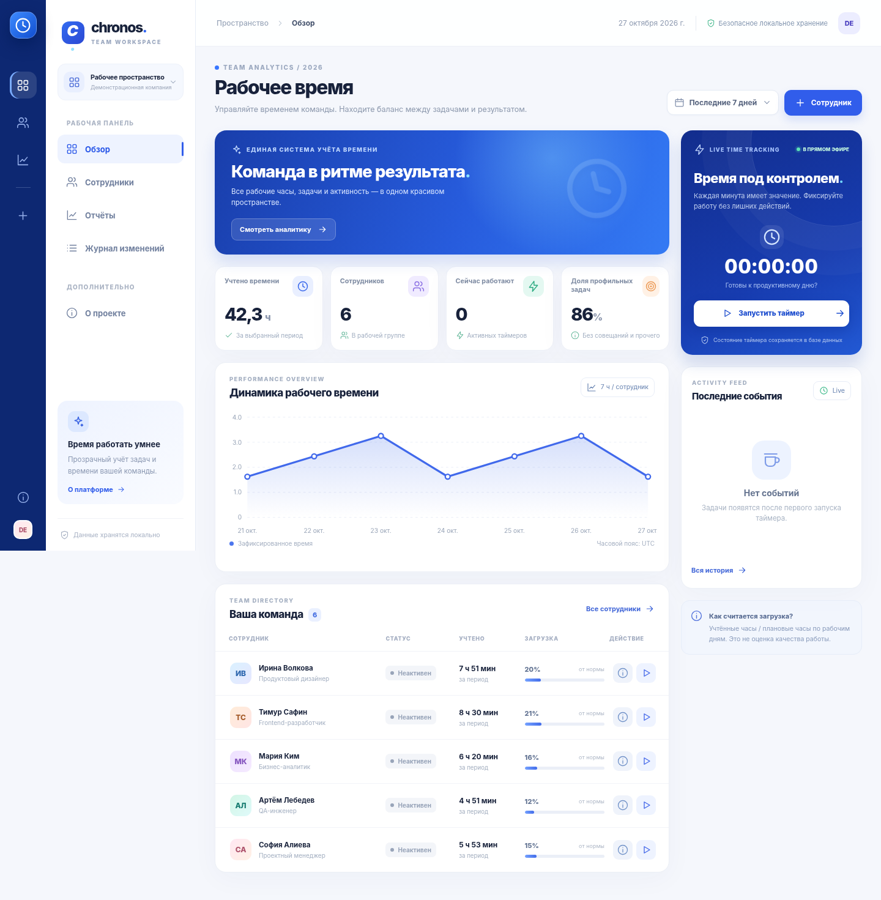

# Chronos Team 2.0 — учёт рабочего времени сотрудников

**Chronos Team** — рабочее, локальное веб-приложение на Python/FastAPI, SQLite и нативном JavaScript.  Все данные в демонстрации вымышлены.

**Версия 2.0 от 27 октября 2026 года:** второй технический аудит и усиление защиты, журнал изменения данных, резервное копирование, ограничение ресурсоёмких отчётов, улучшение доступности и дополнительные тесты.



> Иллюстрация выше — рендер настоящего интерфейса в Chromium **с имитированными HTTP-ответами**, поскольку локальные HTTP-адреса в браузере среды проверки блокируются политикой администратора. HTTP API и работа SQLite проверены отдельно автоматическими тестами. Это не является доказательством сквозного e2e-тестирования браузера с реальным сервером.

## Быстрый запуск

Требуется Python 3.11+ (рекомендуется 3.12 или 3.13). Не требуются Node.js, облачные сервисы, PostgreSQL, ключи API или аккаунты.

**Windows / PowerShell:**

```powershell
py -3 -m venv .venv
.\.venv\Scripts\python.exe -m pip install -r requirements.txt
.\.venv\Scripts\python.exe -m uvicorn app.main:app --host 127.0.0.1 --port 8000
```

**Linux / macOS:**

```bash
python3 -m venv .venv
source .venv/bin/activate
python -m pip install -r requirements.txt
python -m uvicorn app.main:app --host 127.0.0.1 --port 8000
```

Перейдите на **http://127.0.0.1:8000**. Для изменений исходного кода допустим `--reload`, **но только в локальной разработке**. Документация API: http://127.0.0.1:8000/api/docs; спецификация: `/api/openapi.json`.

### Docker (при установленном Docker)

```bash
docker compose up --build
```

Контейнер работает от непривилегированного пользователя, имеет `read_only` файловую систему, монтируемый отдельный том `chronos-data`, сброшенные Linux capabilities и публикацию порта **только на 127.0.0.1**. Сборка контейнера не выполнялась в данной среде; соответствие целевому Docker-хосту необходимо проверить самостоятельно.

## Рабочие сценарии

1. **Сотрудники:** добавить вымышленного сотрудника, открыть карточку, изменить ФИО, должность или недельную норму (1–80 часов).
2. **Таймер:** открыть форму, выбрать сотрудника, указать описание и категорию; запустить. Через несколько секунд остановить. История сохраняется на сервере.
3. **Защита от дублей:** повторный запуск таймера тому же сотруднику возвращает `409 Conflict`; ограничение дублировано в бизнес-логике и частичном `UNIQUE` индексе SQLite.
4. **Отчёт:** выбрать сегодняшний день, неделю, месяц или любой период до 371 дня; фильтровать сотрудника, скачать CSV, исправить описание, удалить *завершённую* запись.
5. **Пустой отчёт:** выбрать период, когда задач не было, — таблица показывает пустое состояние, суммы остаются нулевыми.
6. **История изменений:** открыть «Журнал изменений»; операция и её состояние до/после доступны через `/api/audit`.
7. **Перезапуск:** остановить и вновь запустить сервер. Данные хранятся в SQLite, активный таймер остаётся активным.

### Как считаются показатели

Все времена сохраняются в UTC как целое число миллисекунд. Отчёт использует пересечение двух полуоткрытых интервалов: `[начало записи, конец записи)` и `[начало отчёта, конец отчёта)`. У незакрытых записей конечная граница — один момент времени, полученный сервером для отчёта. При переходе местных суток или летнего времени интервалы разделяются с помощью IANA `zoneinfo`, **а не произвольным делением на 24 часа**.

«Загрузка» = учтённое время / ориентировочное рабочее время (норма часов × рабочие дни / 5). «Доля профильной работы» = время категорий «Разработка», «Тестирование», «Дизайн», «Аналитика» / общее учтённое время. Эти показатели **не измеряют производительность, качество, эффективность, законность рабочего графика или выполнение KPI**; они не учитывают отпуска, праздники, переработки, перерывы и индивидуальные графики. Поэтому приложение не присваивает людям субъективный рейтинг.

## Безопасность и область эксплуатации

> **Важное ограничение тестового задания:** в приложении **нет авторизации**. Оно предназначено только для локальной демонстрации на доверенном устройстве с вымышленными сведениями. **Не публикуйте его в Интернет, не используйте с реальными табелями сотрудников и не выдавайте за сертифицированное приложение.** До эксплуатации с реальными данными требуются как минимум аутентификация/авторизация, полноценная модель доступа к работникам, TLS, политика хранения персональных данных, резервное копирование по регламенту и внешняя проверка безопасности.

Реализованные меры снижения рисков: `TrustedHostMiddleware` против типового DNS rebinding, проверка `Origin`/`Referer`/`Sec-Fetch-Site`, обязательный нестандартный заголовок `X-Chronos-Request: 1` для изменяющих запросов (защита от обычных межсайтовых HTML-форм), отсутствие CORS-разрешений, CSP, `X-Content-Type-Options`, `X-Frame-Options`, `Referrer-Policy`, `Cross-Origin-Resource-Policy`, ограничение тела запросов в том числе без `Content-Length`, строгая серверная валидация Pydantic и SQL-параметры, ограничения целостности SQLite, ограничение максимума записей отчёта (20 000).

**API-клиенты:** при `POST`, `PUT`, `DELETE` отправляют `X-Chronos-Request: 1`; для `POST/PUT` с данными — `Content-Type: application/json`. Пример PowerShell:

```powershell
Invoke-RestMethod -Uri 'http://127.0.0.1:8000/api/employees' `
  -Method Post -Headers @{'X-Chronos-Request'='1'} -ContentType 'application/json' `
  -Body '{"full_name":"Алина Ветрова","position":"QA-инженер","weekly_target_hours":40}'
```

История изменений хранит значения **до и после** операции, в одной транзакции с изменением, с запретом UPDATE/DELETE через SQL-триггеры. Она **не является криптографически защищённым журналом**, не определяет реального оператора (авторизации нет), не заполняется ретроспективно для демозаписей или данных предыдущих версий. Владелец файла SQLite может изменить и сам журнал.

## Резервное копирование и обновление 1.1 → 2.0

**Перед обновлением обязательно сохраните копию своей базы.** Структура 2.0 добавляет таблицу `audit_events` и триггеры без удаления существующих `employees`/`entries`; этот путь проверен тестом миграции. Автоматический откат схемы не предусмотрен.

Сделать согласованную резервную копию **во время работы SQLite в режиме WAL**:

```bash
python -m scripts.backup --output backups/chronos-2026-10-27.sqlite3
```

Можно передать `--database /путь/к/chronos.sqlite3`. Скрипт применяет штатный SQLite Backup API, проверяет `PRAGMA integrity_check`, запрещает перезапись имеющегося файла. **Файл резервной копии содержит все имена и рабочие записи — храните его в защищённом месте.** Для полного disaster-recovery необходимо отдельно проверить восстановление на тестовой машине. Ручное копирование одного `.sqlite3` при активном WAL не считается согласованным резервным копированием.

При первом запуске создаются вымышленные записи. Пустой старт (только до первичной инициализации): `CHRONOS_SEED_DEMO=0`. База по умолчанию: `data/chronos.sqlite3`; альтернативный путь: `CHRONOS_DB`. Папка `data/` и базы исключены из Git.

## Тестирование

```bash
python -m pip install -r requirements-dev.txt
python -m pytest -q --cov=app --cov=scripts --cov-report=term-missing --cov-fail-under=90
python -m compileall -q app scripts
node --check app/static/app.js   # Node.js необязателен для самого приложения
node tests/frontend-check.mjs    # проверки защитного HTML- и CSV-экранирования
```

**Результат проверки версии 2.0 в текущей среде: 29 passed (pytest), покрытие Python-кода 94%, синтаксис JavaScript проверен Node.js.** В отдельном тесте Chromium со **стабами API** успешно отрисовал стартовый экран, открыл форму, добавил сотрудника, запустил таймер и показал журнал изменений; JavaScript-ошибок не зарегистрировано, горизонтального переполнения на узком экране не было. Сквозной тест UI ↔ реальный сервер **не завершён**: локальные HTTP-адреса заблокированы политикой Chromium. Отдельно проверен реально запущенный Uvicorn по HTTP (`health → add employee → start → report → stop → audit`): все шесть запросов успешны. Node.js подтвердил 6 регрессионных проверок экранирования. Сборка Docker, независимый пентест, WCAG-аудит и проверка реального развёртывания **не выполнены**.

Тесты покрывают: добавление и редактирование сотрудников, таймер и повторный запуск, конкурентный запуск (6 и 10 запросов), перезапуск, даты/таймзоны/переход на летнее время, пустой отчёт, редактирование и удаление, безопасность HTTP, фильтры, журнал, миграцию, SQLite backup, URI validation, лимит 20 000 записей и большие HTTP-тела с потоковой передачей.

Подробности: **[TECHNICAL_AUDIT.md](docs/TECHNICAL_AUDIT.md)** и **[SECURITY.md](SECURITY.md)**.

## Стек и архитектура

| Уровень | Реализация |
|---|---|
| UI | HTML5 + CSS3 + JS ES modules, без CDN, без npm-сборки |
| HTTP API | FastAPI, Pydantic v2, OpenAPI |
| Конкурентность | `async def`, конкурентные Fetch API вызовы и `asyncio.to_thread` для SQLite |
| Хранилище | SQLite с WAL, `BEGIN IMMEDIATE`, FK, уникальным индексом, транзакционным аудитом |
| Тесты и автоматизация | pytest, pytest-asyncio, HTTPX ASGITransport, GitHub Actions |
| Поставка | Python venv или непривилегированный Docker-контейнер |

**Асинхронность без преувеличения:** `sqlite3` не является async-драйвером; вызовы исполняются в потоках `asyncio.to_thread`, чтобы не блокировать event loop. SQLite остаётся локальной однописательной БД. Для высокой нагрузки и нескольких узлов понадобится отдельное хранилище (например, PostgreSQL) и другой механизм управления транзакциями; эта архитектура сознательно соответствует масштабу тестового задания.

## Применение искусственного интеллекта

**ИИ-инструмент:** ChatGPT / OpenAI **GPT-6** использован как помощник при проектировании архитектуры, написании и ревью кода, подготовке тестов, аудите угроз, устранении дефектов и документировании решений. Человеческая оценка и автоматические проверки необходимы: ответ нейросети сам по себе **не подтверждает** работоспособность или безопасность. В приложении **нет встроенного AI API**; внешние запросы и расходы при работе не требуются.

Примеры запросов, применённых как ориентир для разработки и проверки (сформулированы для воспроизведения соответствующего процесса, а не как точный лог всех промежуточных вызовов):

1. «Спроектируй локальный учёт рабочего времени на FastAPI и SQLite с атомарным ограничением одного активного таймера на сотрудника; предусмотрите конкурентные запросы и данные после рестарта».
2. «Проверь отчёт по временным интервалам: пересечение полуоткрытых отрезков, текущий таймер, полночь в Asia/Dushanbe и DST в Europe/Berlin. Дай тесты на нулевую длительность и пустой отчёт».
3. «Проведи threat modeling для локального веб-сервера без логина: DNS rebinding, CSRF, XSS, CSV injection, SQL injection, DoS, WAL backup. Предложи защитные меры и негативные тесты».
4. «Проверь транзакционный журнал изменения сотрудника/таймера/записи: не должен записывать ошибки, удаление должно сохранять состояние до операции, старые БД должны мигрировать без потери».
5. «Проанализируй доступность модальных окон и клавиатурную навигацию по WCAG 2.2; не делай ложных утверждений о сертификации».

**Ошибки, обнаруженные и исправленные:**

- Два конкурентных запуска таймера: устранено с помощью `BEGIN IMMEDIATE` и уникального индекса.
- Отчёт мог считывать сотрудников и записи из разных состояний БД: теперь используется одна read-транзакция.
- Гонки первого запуска SQLite: повторные попытки только при временной блокировке.
- Ненадёжная CDN-страница Swagger при строгом CSP: заменена локальной документацией.
- Межсайтовые запросы на localhost могли менять состояние: проверка источника + нестандартный заголовок.
- Удаление/правки не имели следа: добавлен транзакционный журнал с before/after.
- Отчёт сканировал все календарные дни для **каждой** записи: расчёт ограничен фактическими днями пересечения; добавлен лимит размера выборки.
- Возможная формульная интерпретация CSV при невидимых префиксах: дополнительное экранирование.
- Клавиатурный фокус мог оказаться за модальным окном: фон переводится в `inert`, фокус возвращается к вызвавшей кнопке, добавлено закрытие Esc и управление видимостью фокуса.

Внимание: история правок фиксирует факты в новой базе, **но не доказывает личность автора** без авторизации.

## Международные ориентиры качества

Проведено **сопоставление отдельных требований**, а не сертификация или проверка полного перечня: [OWASP ASVS 5.0.0](https://asvs.owasp.org/), [OWASP CSRF Prevention Cheat Sheet](https://cheatsheetseries.owasp.org/cheatsheets/Cross-Site_Request_Forgery_Prevention_Cheat_Sheet.html), [NIST SP 800-218 SSDF](https://csrc.nist.gov/pubs/sp/800/218/final), [ISO/IEC 25010:2023](https://www.iso.org/standard/78176.html) и [WCAG 2.2](https://www.w3.org/TR/WCAG22/).

Сильные стороны в рамках тестового задания: корректность функциональности, транзакционная целостность, определённые ограничения ресурсов, воспроизводимые тесты и читаемая документация. Отложены: полноценная авторизация, формализованные нормы конфиденциальности и хранения данных, высокий уровень доступности/мультинодовая БД, углублённая автоматическая проверка зависимостей, полноценное инструментальное тестирование доступности, внешняя оценка безопасности. Смотрите матрицу контроля в `docs/TECHNICAL_AUDIT.md`.

## Публикация на GitHub

Никогда не добавляйте `data/*.sqlite3`, `.env`, личные данные, токены и резервные копии в Git. Папка `data/` исключена через `.gitignore`. Создайте **пустой публичный репозиторий** на GitHub, затем из каталога проекта выполните:

```bash
git init
git add .
git commit -m "feat: Chronos Team 2.0 audited time tracking app"
git branch -M main
git remote add origin https://github.com/YOUR_USERNAME/chronos-team.git
git push -u origin main
```

Замените `YOUR_USERNAME`; при необходимости настройте SSH или GitHub CLI. **Публичная ссылка не создана автоматически** и будет доступна после вашей публикации. В анкету вставьте URL созданного репозитория.

## Лицензия

MIT — см. [LICENSE](LICENSE). Публикация под MIT относится к исходному коду Chronos Team, а не к наименованиям или фирменным материалам сторонних продуктов.
